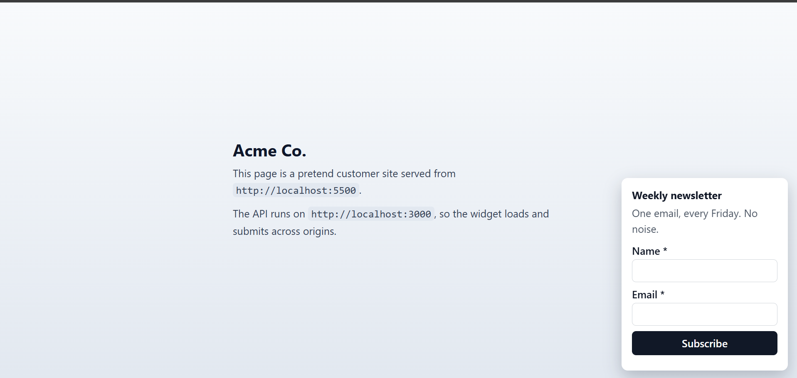
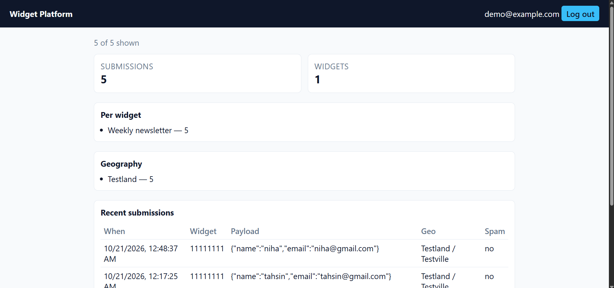

# Embeddable Widget & Lead-Capture Platform

A backend platform for embeddable lead-capture forms. A business owner creates a widget (a newsletter signup, contact form, or CTA popover) and gets one line of HTML to paste into any website. Visitors fill out the form on that site; this service validates the submission, filters abuse, adds approximate location, stores the lead, and shows it in the owner's dashboard.

| Customer site | Dashboard |
| --- | --- |
|  |  |

## What the demo shows

`npm run seed` creates `demo@example.com` and an active **Weekly newsletter** widget. Open `http://localhost:5500/`; after two seconds this card appears in the bottom-right corner:

```
+--------------------------------------+
| Weekly newsletter                    |
| One email, every Friday. No noise.   |
|                                      |
| Name *                               |
| [                                  ] |
| Email *                              |
| [                                  ] |
| [             Subscribe            ] |
+--------------------------------------+
```

Submit it, then log in to `http://localhost:3000/dashboard/` as `demo@example.com` / `demo-password-123`; the row appears under totals, per-widget counts, recent submissions, and the geo breakdown (local mock geo reports `Testland`). Mailpit at `http://localhost:8025` receives the notification email.

## What it does

- **Create widgets:** an owner registers, logs in, and creates widgets with a title, description, form fields, button text, and display options. Each widget is private to its owner.
- **Embed anywhere:** the API returns a one-line `<script>` snippet. On the customer's page it loads a cached, versioned bundle, fetches the widget's small config, and renders the form.
- **Accept submissions safely:** visitors submit from other websites. The public endpoint handles CORS, validates every field, rate-limits by IP and widget, and catches honeypot spam.
- **Enrich and notify:** each valid submission gets IP-based geo data with a provider fallback chain, is stored, and triggers an owner email. If geo or email fails, the submission still succeeds.
- **Report:** the owner logs into a dashboard to see recent submissions, totals, per-widget counts, and a geo breakdown.

In one sentence: **the backend behind a form you can paste onto any website**, handling tenancy, cached delivery, abuse protection, graceful degradation, and reporting.

## Architecture

```
           Widget Owner (authenticated)                       Customer Website (any origin)
       +----------------------------------+              +------------------------------------+
       |  Admin API  (Bearer JWT)         |              |  <script src=".../widget.js?id=.."> |
       |  widgets CRUD, snippet, stats    |              +----------------+-------------------+
       +---------------+------------------+                               |
                       |                              GET /widgets/:id/config   (public, cached, CORS)
                       v                                                  |
              +------------------+                                         v
              |    PostgreSQL    |                                 render widget on the page
              |  users           |                                         |
              |  widgets         |                                         v
              |  submissions     |                       POST /submissions   (public, CORS)
              +--------^---------+                                         |
                       |              +------------------------------------+
                       |              v
                       |    validate -> rate limit (IP, widget) -> spam check
                       |              |
                       |              v
                       |    geo: provider A -> provider B -> none   (degrade, never fail)
                       |              |
                       |              v
                       |    store submission
                       |              |
                       |              v
                       |    email / webhook side effect   (failure never blocks success)
                       |              |
                       +--------------+
```

## Setup

Requires Node.js 20+ and Docker Compose v2.

```bash
docker compose up -d        # PostgreSQL 16 + Mailpit
npm install
cp .env.example .env        # fill in values; never commit .env
npm run seed                # demo owner + widget (demo@example.com / demo-password-123)
npm run dev
```

Run the customer test page from a second terminal; it is served on `:5500`, a different origin from the API:

```bash
npm run customer-site       # http://localhost:5500
```

Dashboard: open `http://localhost:3000/dashboard/` and log in with `demo@example.com` / `demo-password-123` (seeded) or your own account.

With the API running, `npm run smoke` checks the public flow (32 checks). Mailpit (caught emails) is at `http://localhost:8025`.

## Embed

`POST /api/widgets` returns a one-line snippet:

```html
<script src="http://localhost:3000/widget.js?id=<widget-id>&v=v1" async></script>
```

The bundle is cached immutably per `WIDGET_SCRIPT_VERSION`; `GET /widgets/:id/config` (CORS `*`, 60 s cache) supplies the form. The seeded demo page embeds widget `11111111-1111-4111-8111-111111111111`.

## API

Admin (Bearer JWT): `POST /api/auth/register`, `POST /api/auth/login`, `GET /api/auth/me`, `POST|GET /api/widgets`, `GET|PATCH|DELETE /api/widgets/:id`, `GET /api/submissions`, `GET /api/stats/overview`.

Public (anonymous, CORS): `GET /widget.js?id&v`, `GET /widgets/:id/config`, `POST /submissions`. A bare dashboard page is served at `/dashboard/`.

Full contracts, status codes, and error shapes: `docs/DESIGN.md` (API contracts).

## Limitations

- Rate limits are in-memory: they reset on restart and do not coordinate across processes.
- Geo lookups use free public APIs; fallback proofs use deterministic mocks.
- Email goes to local Mailpit only and is never retried after a failure.
- The widget shows one prompt per page load; targeting is limited to position and delay.
- The dashboard is a bare table with an email/password login; there are no charts.
- The demo snippet and seed are localhost-only and use a fixed widget id.

## License

MIT - see `LICENSE`.
